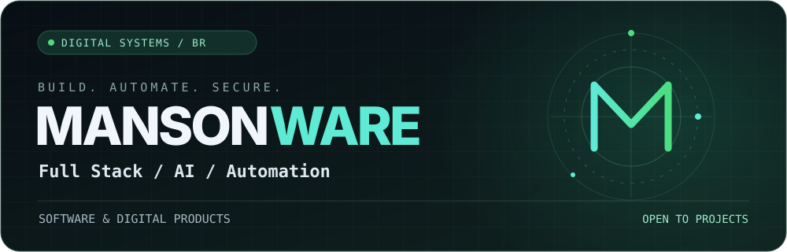

  

  <h3>Transformando ideias em produtos digitais e automações reais.</h3>

  
  
  

## 01 / Sobre mim

Sou desenvolvedor Full Stack autodidata e criador de soluções digitais. Trabalho com **inteligência artificial, automação, aplicações web e integrações**, buscando transformar necessidades reais em software simples, seguro e útil.

Na **Mansonware**, desenvolvo produtos e soluções com foco em experiência do usuário, eficiência operacional e resultados comerciais. Também estudo cibersegurança, Linux e redes com foco ético e defensivo.

## 02 / O que eu construo

| Área | Soluções |
| :--- | :--- |
| **Full Stack** | Sites, plataformas web, SaaS, e-commerce e MVPs |
| **IA aplicada** | Assistentes inteligentes e integração de modelos de IA |
| **Automação** | WhatsApp, APIs, fluxos de trabalho e processos empresariais |
| **Segurança** | Ferramentas de diagnóstico, Linux e laboratórios educacionais |

## 03 / Projetos em destaque

| Projeto | Descrição | Explorar |
| :--- | :--- | :--- |
| **Mansonware** | Portfólio de serviços digitais, sistemas e automações sob medida. | [Site](https://mansonware-portfolio.vercel.app) · [Código](https://github.com/Mansonware/mansonware-portfolio) |
| **Manson Cyber Lab** | Plataforma educacional de cibersegurança e aprendizado prático. | [Plataforma](https://manson-cyber-lab.vercel.app/) |
| **Dev no Bolso** | Plataforma de ensino de programação pelo celular, com IA e área do aluno. | [Site](https://dev-no-bolso.vercel.app) · [Código](https://github.com/Mansonware/dev-no-bolso) |
| **System Intelligence** | Ferramenta Python para diagnóstico e monitoramento de sistemas. | [Código](https://github.com/Mansonware/system_info) |
| **Site Generator** | Gerador de sites HTML, CSS e JS com Python. | [Código](https://github.com/Mansonware/site-generator-python) |

## 04 / Stack tecnológica

  
   
  

**Desenvolvimento:** APIs REST, bancos de dados, autenticação, integrações de pagamento e deploy.

**IA & automação:** desenvolvimento assistido por agentes, engenharia de prompts e automação de fluxos.

## 05 / Atividade no GitHub

  

Cyber Lab / interface experimental

 

  

Estudos em segurança de aplicações, redes, Linux e ferramentas de análise em ambientes autorizados.

---

  <h3>Tem um problema que pode ser resolvido com tecnologia?</h3>
  
Aberto a oportunidades profissionais, projetos e parcerias.

  <a href="https://mansonware-portfolio.vercel.app"><strong>Conheça meu trabalho e entre em contato</strong></a>
    
  MANSONWARE / BUILD · AUTOMATE · SECURE

